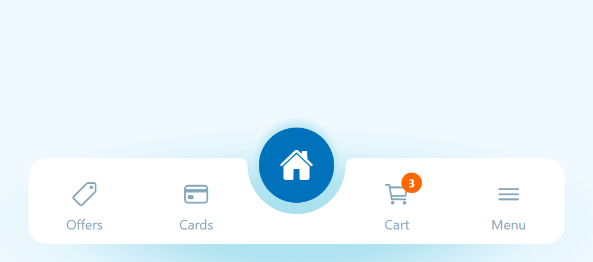
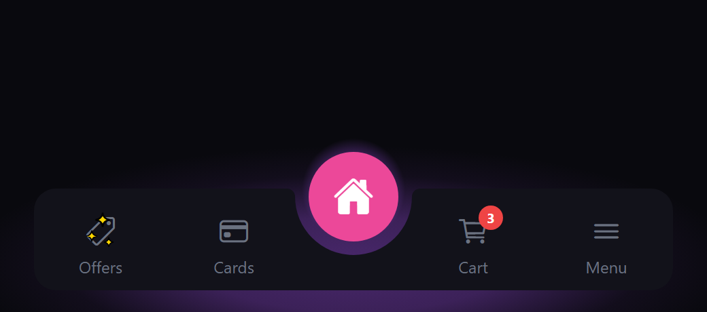
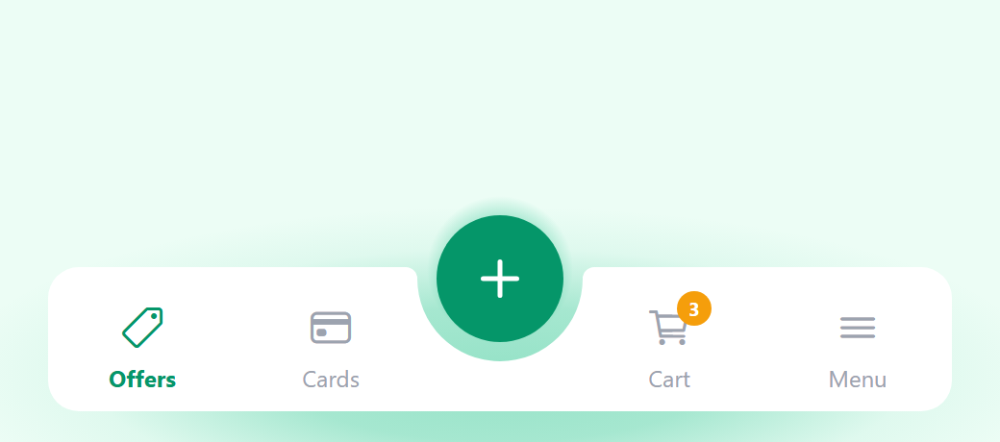
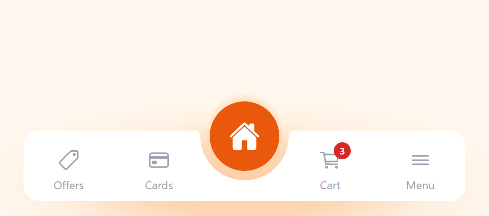

# @atta-hamamah/react-native-curved-tabbar

[](https://www.npmjs.com/package/@atta-hamamah/react-native-curved-tabbar)
[](LICENSE)

A curved bottom tab bar for [React Navigation](https://reactnavigation.org) with a notched, floating center button, ambient glow and animated sparkles.

One line to use. Every part can be customized when you need it.

<p align="center">
  
  
  
  
</p>

- **Works with what you already have.** Uses your screens' `tabBarIcon`, `tabBarLabel`, `tabBarBadge` and the rest of the standard options.
- **Center button that fits.** The notch is computed from the button size, so changing one number keeps everything aligned.
- **Two center modes.** Navigate to a tab, or run an action such as opening a modal, without switching tabs.
- **Screens know its height.** `useBottomTabBarHeight()` returns the real height, so your content scrolls clear of the bar.
- **Themes, glow and sparkles** built in, plus render slots to replace the background, the tabs or the sparkles.
- iOS, Android and web. Fully typed.

## Installation

```sh
npm install @atta-hamamah/react-native-curved-tabbar
```

It needs `react-native-svg` and React Navigation's bottom tabs. Skip any you already have:

```sh
npm install react-native-svg @react-navigation/native @react-navigation/bottom-tabs react-native-safe-area-context react-native-screens
```

With Expo, use `npx expo install` for those packages so you get versions that match your SDK. All of them work in Expo Go.

## Quick start

Pass `CurvedTabBar` as the navigator's `tabBar`:

```tsx
import { createBottomTabNavigator } from '@react-navigation/bottom-tabs';
import { CurvedTabBar } from '@atta-hamamah/react-native-curved-tabbar';
import { Ionicons } from '@expo/vector-icons';

const Tab = createBottomTabNavigator();

export function Tabs() {
  return (
    <Tab.Navigator
      tabBar={(props) => <CurvedTabBar {...props} />}
      screenOptions={{ headerShown: false }}
    >
      <Tab.Screen
        name="Offers"
        component={OffersScreen}
        options={{ tabBarIcon: ({ color, size }) => <Ionicons name="pricetag-outline" size={size} color={color} /> }}
      />
      <Tab.Screen
        name="Cards"
        component={CardsScreen}
        options={{ tabBarIcon: ({ color, size }) => <Ionicons name="card-outline" size={size} color={color} /> }}
      />
      <Tab.Screen
        name="Home"
        component={HomeScreen}
        options={{ tabBarIcon: ({ color, size }) => <Ionicons name="home" size={size} color={color} /> }}
      />
      <Tab.Screen
        name="Cart"
        component={CartScreen}
        options={{
          tabBarBadge: 3,
          tabBarIcon: ({ color, size }) => <Ionicons name="cart-outline" size={size} color={color} />,
        }}
      />
      <Tab.Screen
        name="Menu"
        component={MenuScreen}
        options={{ tabBarIcon: ({ color, size }) => <Ionicons name="menu-outline" size={size} color={color} /> }}
      />
    </Tab.Navigator>
  );
}
```

With an odd number of tabs, the middle one (`Home` here) becomes the raised center button, using its own `tabBarIcon`. The others are split evenly to the left and right, in the order you declared them.

## The center button

Use the `center` prop to choose what goes in the middle:

```tsx
// Default: with an odd number of tabs, the middle tab
<CurvedTabBar {...props} />

// A specific tab, wherever it is declared
<CurvedTabBar {...props} center="Home" />

// An action button that doesn't switch tabs (works with any number of tabs)
<CurvedTabBar
  {...props}
  center={{
    icon: ({ color, size }) => <Ionicons name="add" size={size} color={color} />,
    onPress: () => openCreateSheet(),
  }}
/>

// No center button and no notch: a plain floating bar
<CurvedTabBar {...props} center={false} />
```

To change the center button without picking a route, pass options without `route` or `onPress`. The middle tab is still used:

```tsx
<CurvedTabBar {...props} center={{ size: 74, sparkles: true, pressAnimation: false }} />
```

`onPress` receives the tab navigator's `navigation`, so an action button can also open a screen outside the tabs: `onPress: (navigation) => navigation.navigate('NewPost')`.

If there is no center button and you didn't pass `center`, for example with 4 tabs, you get a warning in development. Pass `center={false}` to keep a plain bar and hide it.

| `center` option | Type | Default | |
| :--- | :--- | :--- | :--- |
| `route` | `string` | middle tab (odd tab count) | Route the button navigates to. |
| `onPress` | `(navigation) => void` | | Called instead of navigating. Without `route`, makes an action button. |
| `icon` | `ReactNode \| ({ focused, color, size }) => ReactNode` | route's `tabBarIcon`, then a built-in icon | Icon inside the button. |
| `size` | `number` | `66` | Diameter. The notch resizes to fit. |
| `sparkles` | `boolean` | `false` | Animated sparkles on the button. |
| `pressAnimation` | `boolean` | `true` | Spring scale when pressed. |
| `accessibilityLabel` | `string` | route's label | |
| `testID` | `string` | route's `tabBarButtonTestID` | |

## Theming

Pick a preset, then override any color:

```tsx
<CurvedTabBar {...props} theme="dark" />

<CurvedTabBar {...props} theme="dark" colors={{ bar: '#000000', centerActive: '#22D3EE' }} />
```

Presets: `ocean` (default), `dark`, `emerald`, `sunset`. Each one is exported as `THEMES`, so you can build on it.

| Color | Used for |
| :--- | :--- |
| `bar` | The bar fill |
| `glow` | Glow behind the bar and the center button |
| `active` / `inactive` | Tab icon and label |
| `centerActive` / `centerInactive` | Center button when its tab is focused / not focused. Action buttons always use `centerActive`. |
| `centerIcon` | Icon inside the center button |
| `badge` / `badgeText` | Badges |
| `sparkle` | Default sparkle stars |

Screen options win over the theme, so `tabBarActiveTintColor`, `tabBarInactiveTintColor` and `tabBarBadgeStyle` keep working.

## Sparkles

List the tabs that should sparkle. This includes the center route:

```tsx
<CurvedTabBar {...props} sparkles={['Offers', 'Home']} />
```

To replace the stars with your own animation, use `renderSparkles`. It runs for every tab that has sparkles, so you can vary it by route:

```tsx
<CurvedTabBar
  {...props}
  sparkles={['Offers', 'Cart']}
  renderSparkles={({ routeName, focused }) =>
    routeName === 'Cart' ? <PulsingDot /> : <FireEmoji active={focused} />
  }
/>
```

## Size, notch and glow

```tsx
<CurvedTabBar
  {...props}
  height={70}
  cornerRadius={24}
  marginHorizontal={12}
  center={{ size: 60 }}
  notch={{ gap: 8, depth: 30 }}   // shallower notch; the button rises to stay 8pt above its bottom
  glow={{ bar: false }}           // or glow={false} to turn off both
/>
```

| `notch` option | Default | |
| :--- | :--- | :--- |
| `gap` | `10` | Space between the button and the notch edge. |
| `radius` | `size / 2 + gap` | Half-width of the notch. |
| `depth` | `radius` | Depth of the notch. |
| `shoulder` | `6` | Rounding where the bar's top edge meets the notch. |

## Keeping content above the bar

The bar floats over your screens. React Navigation's `useBottomTabBarHeight()` returns its real height, including the raised center button and the bottom safe area:

```tsx
import { useBottomTabBarHeight } from '@react-navigation/bottom-tabs';

function OffersScreen() {
  const tabBarHeight = useBottomTabBarHeight();
  return <ScrollView contentContainerStyle={{ paddingBottom: tabBarHeight }}>{/* ... */}</ScrollView>;
}
```

## Full customization

When the props aren't enough, replace parts of the bar. Each render function receives everything the default implementation uses.

```tsx
import { CurvedBackground, TabBarItem } from '@atta-hamamah/react-native-curved-tabbar';

<CurvedTabBar
  {...props}
  // The bar surface. `path` is the SVG outline, notch included, so you can clip or mask with it.
  renderBackground={(bg) => (
    <>
      <CurvedBackground {...bg} />
      <MyShineOverlay width={bg.width} height={bg.height} path={bg.path} />
    </>
  )}
  // Each side tab. `onPress` and `onLongPress` already handle navigation and tab events.
  renderTabItem={(tab) => (
    <View style={{ flex: 1 }}>
      <TabBarItem {...tab} />
      {tab.focused && <ActiveDot color={tab.color} />}
    </View>
  )}
/>
```

## React Navigation options it respects

`tabBarIcon`, `tabBarLabel` (string or function), `title`, `tabBarBadge`, `tabBarBadgeStyle`, `tabBarActiveTintColor`, `tabBarInactiveTintColor`, `tabBarLabelStyle`, `tabBarIconStyle`, `tabBarShowLabel`, `tabBarLabelVisibilityMode: 'unlabeled'`, `tabBarAccessibilityLabel` and `tabBarButtonTestID`. It also emits `tabPress` and `tabLongPress`, so `e.preventDefault()` and scroll-to-top on a second press work as usual.

## All props

`CurvedTabBar` takes the props React Navigation passes to `tabBar`, plus:

| Prop | Type | Default |
| :--- | :--- | :--- |
| `theme` | `'ocean' \| 'dark' \| 'emerald' \| 'sunset'` | `'ocean'` |
| `colors` | `Partial<TabBarColors>` | |
| `center` | `string \| CenterButtonOptions \| false` | middle tab |
| `sparkles` | `string \| string[]` | |
| `glow` | `boolean \| { bar?: boolean; center?: boolean }` | `true` |
| `notch` | `NotchOptions` | fits the center button |
| `height` | `number` | `75` |
| `cornerRadius` | `number` | `16` |
| `marginHorizontal` | `number` | `16` |
| `hideOnKeyboard` | `boolean` | `true` |
| `style` | `StyleProp<ViewStyle>` | |
| `renderBackground` | `(props: TabBarBackgroundProps) => ReactNode` | |
| `renderTabItem` | `(props: TabItemProps) => ReactNode` | |
| `renderSparkles` | `(props: SparkleRenderProps) => ReactNode` | |

All of these types are exported.

## Requirements

- React Native 0.71 or newer
- React Navigation 7 (6 should work too, but only 7 is tested so far)
- `react-native-svg` 12 or newer

## Example app

The [`example/`](example) folder has an Expo app where you can switch themes, center modes, sparkles and notch sizes live. It loads the library straight from `src/`, so your edits show up on reload.

```sh
git clone https://github.com/atta-hamamah/react-native-curved-tabbar.git
cd react-native-curved-tabbar/example
npm install
npm start
```

Press `w` for the web, or scan the QR code with Expo Go.

## Contributing

```sh
npm install
npm run typecheck
npm test
```

Issues and pull requests are welcome.

## License

[MIT](LICENSE)
